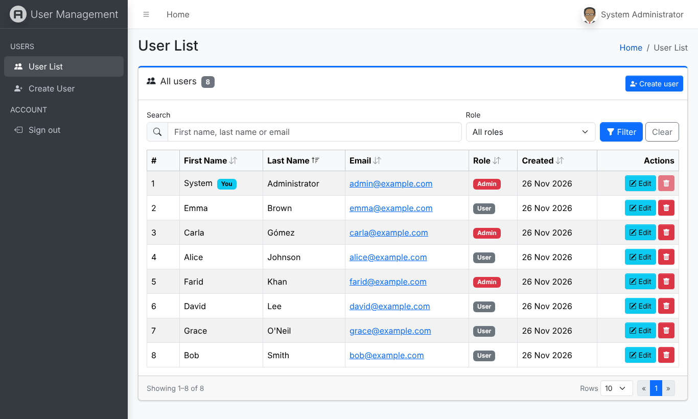
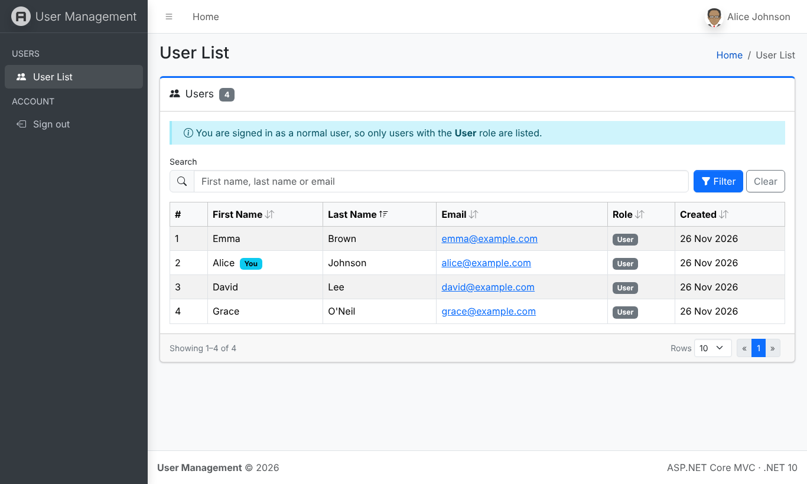

# ClaudeDemo

A base repository for Claude Code samples.

## Sample: User Management (ASP.NET Core MVC)

A user management web app built with **ASP.NET Core MVC on .NET 10 (LTS)**, **Entity Framework Core 10** on **SQL Server Express**, and the **AdminLTE 4.10** theme on **Bootstrap 5.3.8**.

| Admin view | Normal user view |
|---|---|
|  |  |

### Features

| Module | What it does |
|---|---|
| **Registration** (`/Account/Register`) | First name, last name, email, role (Admin/User), password and confirmation. Validation runs in the browser and again on the server: required fields, name characters, email format, duplicate email, password strength (8+ characters with upper-case, lower-case and a digit), and password match. |
| **Login** (`/Account/Login`) | The username is the registered email. Both fields are validated. A successful login redirects to the **user list**. Passwords are hashed with ASP.NET Core's `PasswordHasher` (PBKDF2). |
| **User list** (`/Users`) | Normal users see **only users with the User role**. Admins see everyone. The grid has search, a role filter (admin only), sortable columns (click a header to toggle asc/desc), and paging with a page-size picker. |
| **Address** (Edit User page) | Optional postal address per user: Address 1, Address 2, City, State (Indian states and union territories dropdown), Country (India / Russia dropdown) and a 6-digit Pincode. Leave everything blank for no address; if any field is filled, all but Address 2 are required. |
| **Admin management** | Admins can create, edit and delete users. Delete asks for confirmation in a modal. Admins can't delete their own account or remove their own Admin role, so they can't lock themselves out. Non-admins get *Access denied* on these pages. |

On every request the auth cookie is checked against the database. A deleted user is signed out, and a user whose role changes gets the new permissions on their next request.

### Project layout

```
UserManagement.sln
src/UserManagement.Web/          ASP.NET Core MVC app
  Controllers/                   AccountController, UsersController, HomeController
  Data/                          AppDbContext, DbInitializer (migrate + seed admin), Migrations/
  Models/ ViewModels/            Entities (AppUser, UserAddress), dropdown options, view models with validation attributes
  Services/                      UserService (CRUD, filter/sort/page), AuthCookieHelper
  Views/                         AdminLTE layout (_Layout), login/register layout (_AuthLayout)
  wwwroot/lib/                   AdminLTE, Bootstrap, Bootstrap Icons, jQuery validation (vendored, no CDN)
tests/UserManagement.Tests/      End-to-end integration tests (in-memory database)
database/CreateDatabase.sql      Idempotent SQL script, if you'd rather create the schema by hand
run-chrome.cmd / .ps1 / .sh     Build, run and open the site in Google Chrome
```

### Prerequisites

- [.NET 10 SDK](https://dotnet.microsoft.com/download/dotnet/10.0)
- SQL Server Express (or any SQL Server edition)
- Google Chrome

### Configure the database connection

The connection string is `ConnectionStrings:DefaultConnection` in `src/UserManagement.Web/appsettings.json`. The default value points at a local SQL Express instance using Windows authentication:

```
Server=.\SQLEXPRESS;Database=UserManagementDb;Trusted_Connection=True;TrustServerCertificate=True;MultipleActiveResultSets=true
```

To use your own server, set the value in any of these places (later ones override earlier ones):

1. `appsettings.json`
2. User secrets, so credentials stay out of source control:
   ```bash
   dotnet user-secrets set "ConnectionStrings:DefaultConnection" "Server=MYHOST\SQLEXPRESS;Database=UserManagementDb;User Id=app;Password=...;TrustServerCertificate=True" --project src/UserManagement.Web
   ```
3. Environment variable `ConnectionStrings__DefaultConnection`

On startup the app creates the database and applies migrations automatically. To turn that off, set `Database:ApplyMigrationsOnStartup` to `false`, then run `database/CreateDatabase.sql` or `dotnet tool restore && dotnet ef database update --project src/UserManagement.Web` yourself.

### Default admin account

If the database has no admin, one is created on startup from the `SeedAdmin` settings:

- **Username:** `admin@example.com`
- **Password:** `Admin@12345`

**Change this password (or the `SeedAdmin` settings) before deploying anywhere real.**

### Build and run in Google Chrome

**Windows:** double-click `run-chrome.cmd` in the repository folder, or run it from a terminal opened in that folder:
```bash
.\run-chrome.cmd
```
(Equivalent PowerShell command, typed as one line including the leading `powershell`: `powershell -ExecutionPolicy Bypass -File .\run-chrome.ps1`)

**macOS / Linux:**
```bash
./run-chrome.sh
```

Each script trusts the dev HTTPS certificate, builds the app, starts it on `https://localhost:7180`, and opens the login page in Chrome.

**Visual Studio 2022/2026:** open `UserManagement.sln`, choose **Google Chrome** in the browser drop-down next to the green *Run* button (or *Browse With… → Google Chrome → Set as Default*), then press F5. Visual Studio keeps that browser choice on your machine, so it isn't committed to the repo.

**VS Code:** open the repo folder and run the **UserManagement.Web (Chrome)** launch configuration (F5). It builds the app and opens Chrome with the debugger attached.

**Command line:**
```bash
dotnet run --project src/UserManagement.Web --launch-profile https
```
This opens your *default* browser.

### Tests

```bash
dotnet test
```

The tests run the whole app in memory with an in-memory database. They cover: redirect to login, registration validation, duplicate email, login success and failure, the redirect to the user list, normal users seeing only normal users and being blocked from admin pages, admin create/filter/sort/edit/delete, and admins being unable to delete or demote themselves.

### Settings reference (`appsettings.json`)

| Key | Default | Purpose |
|---|---|---|
| `ConnectionStrings:DefaultConnection` | local SQL Express | Database connection |
| `Database:ApplyMigrationsOnStartup` | `true` | Create/upgrade the schema at startup |
| `SeedAdmin:*` | admin@example.com / Admin@12345 | First admin account, created only if no admin exists |
| `Registration:AllowAdminRole` | `true` | Whether the public registration page offers the **Admin** role. Set it to `false` in production so only admins can create admins. |
